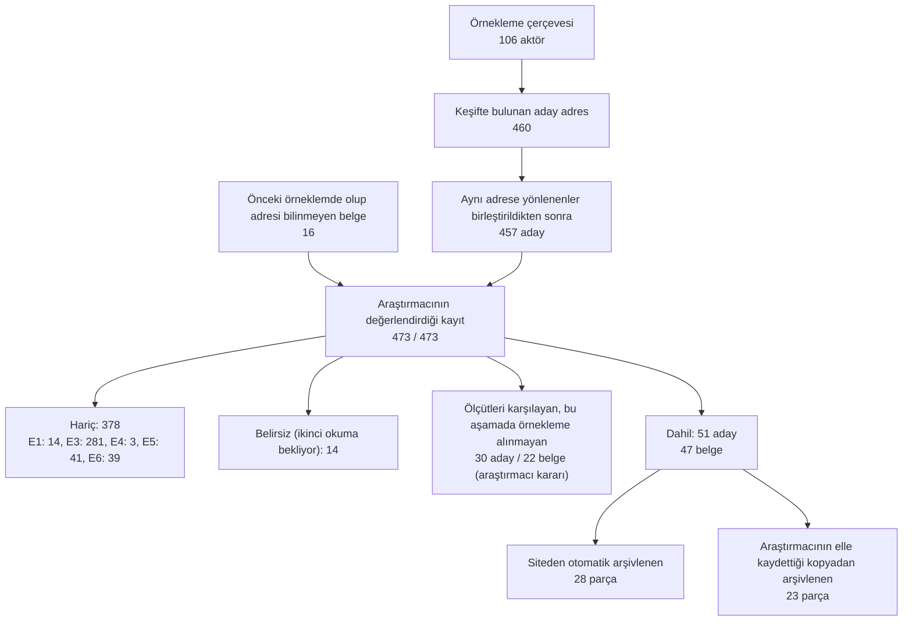

# Veri Toplama Raporu

Bu rapor `scripts/07_rapor.py` tarafından otomatik üretilmiştir. Tüm sayılar proje dosyalarından hesaplanır.

## 1. Çalıştırma bilgisi

| Bilgi | Değer |
|---|---|
| Rapor zamanı (UTC) | 2026-10-10T15:36:27Z |
| Python | 3.12.15 |
| İşletim sistemi | Darwin x86_64 |
| Git commit | 589211b (main) |
| Protokol | 1.3 (10 Ekim 2026) |
| User-Agent | `CIDA2026-AcademicResearch/1.0 (non-commercial research; contact: turancan.sirvanli@kocaeli.edu.tr)` |
| Alan başı bekleme | 5 sn |

Paket sürümleri: requests 2.34.2, tenacity 9.2.1, beautifulsoup4 4.15.0, lxml 6.1.3, ultimate-sitemap-parser 1.8.1, trafilatura 2.3.1, playwright 1.63.0, pypdf 6.20.0, pandas 3.0.6, openpyxl 3.1.5, pyyaml 6.0.3, rapidfuzz 3.14.6, pytest 9.1.1, protego 0.7.0.

## 2. Akış şeması

## 3. Örnekleme çerçevesi (Aşama 1)

Çerçevede **106 aktör** vardır. Web aramaları ve kaynak sayfa okumaları `logs/arama_gunlugu.csv` dosyasına kaydedilmiştir (24 kayıt: WebFetch 12, WebSearch 12).

| Kaynak türü | Aktör |
|---|---|
| tohum | 47 |
| literatür | 41 |
| web araması | 13 |
| yeniden değerlendirme | 3 |
| dizin | 2 |

Literatür listelerinde veya aramada görülüp araştırmacı kararıyla çerçeveye alınmayan aktör: 5 (OFCOM, Adobe, Prodigioso Volcán, Stanford Daily, Quanta Magazine).

Erişilemeyen kaynaklar (engel aşılmamıştır):

| Adres veya sorgu | Not |
|---|---|
| https://www.mdpi.com/2673-5172/6/1/29 | Sánchez-García vd. 2025: HTTP 403; örneklem listesi alınamadı |
| https://doi.org/10.1007/s00146-024-01973-5 | de-Lima-Santos vd. 2025: Springer giriş sayfasına yönlendirdi; izlenmedi |
| https://www.tandfonline.com/doi/full/10.1080/21670811.2024.2431519 | Becker vd. 2025: HTTP 403; izlenmedi |
| https://researchers.mq.edu.au/files/432094609/Publisher_version.pdf | HTTP 403; izlenmedi |
| https://uvadoc.uva.es/handle/10324/85446 | Bağlantı reddedildi; Sánchez-García vd. listesi alınamadı |

## 4. Keşif (Aşama 2)

106 aktör işlenmiş, **460 aday adres** bulunmuştur.

| Bulunma yolu | Aday |
|---|---|
| sitemap | 202 |
| gezinme | 132 |
| etik_kod | 81 |
| tohum | 32 |
| arama | 13 |

| Aktör düzeyinde erişim | Aktör |
|---|---|
| Ana sayfası alınan ve taranan | 78 |
| Engellendi (robots.txt, HTTP 403 veya robots.txt alınamadı); taranmadı | 24 |
| Hata (sunucu hatası, yönlendirme döngüsü) | 2 |
| Alan adı bulunamadı | 2 |

Site haritası dosya üst sınırına (25 dosya) takılan aktör: 31. Gezinmede alan adı başına en fazla 40 sayfa indirilmiştir. Arama katmanı, Aşama 1 aramalarında bulunan adreslerle sınırlıdır (`data/interim/arama_sonuclari.csv`).

Engellenen veya hata veren aktörler:

| Aktör | Kurum | Durum |
|---|---|---|
| A011 | De Volkskrant | volkskrant.nl: engellendi |
| A012 | DPG Media | dpgmediagroup.com: engellendi |
| A015 | Dagens Næringsliv | dn.no: hata |
| A027 | ITN | itn.co.uk: engellendi |
| A028 | Financial Times | ft.com: engellendi |
| A029 | The Atlantic | theatlantic.com: engellendi |
| A045 | PBS | pbs.org: engellendi |
| A048 | States Newsroom | newjerseymonitor.com: engellendi |
| A054 | Impress (İngiltere) | impressorg.com: engellendi |
| K01 | Associated Press (AP) | ap.org: engellendi |
| K02 | Agence France-Presse (AFP) | afp.com: engellendi |
| K08 | CBC/Radio-Canada | cbc.ca: engellendi |
| K09 | NPR | npr.org: engellendi |
| K10 | RTVE | rtveia.es: engellendi |
| K16 | Mediahuis | mediahuis.com: engellendi |
| K20 | Groupe Les Echos-Le Parisien | leparisien.fr: engellendi; lesechos.fr: engellendi |
| K21 | Estadão (Grupo Estado) | estadao.com.br: engellendi |
| K22 | Nation Media Group (NMG) | nation.africa: engellendi |
| K29 | Todo Jujuy | todojujuy.com: engellendi |
| M03 | DJV (Deutscher Journalisten-Verband) | djv.de: hata |
| M11 | Türkiye Gazeteciler Cemiyeti (TGC) | tgc.org.tr: engellendi |
| M13 | GDA ve Türkiye basın/medya konseyleri – Ohri Bildirgesi | medijskisavjet.me: engellendi; seecheck.org: tamam |
| M15 | Press Council of Serbia | savetzastampu.rs: engellendi |
| M17 | Media Council for Self-Regulation (Karadağ) | medijskisavjet.me: engellendi |
| M18 | Society of Professional Journalists (SPJ) | spj.org: engellendi |
| Y01 | Deutscher Presserat | presserat.de: engellendi |

## 5. Ön puanlama ve eleme (Aşama 3)

Aynı adrese yönlenen 3 aday birleştirilmiş, 457 aday puanlanmıştır. Önceki örneklemde olup adresi bilinmeyen 16 belge forma ayrıca eklenmiştir; form 473 kayıt içerir. Ön puan yalnızca sıralama için kullanılmıştır; kararların tamamı araştırmacıya aittir.

| Adayın sayfasına erişim | Aday |
|---|---|
| tamam | 403 |
| engellendi | 51 |
| hata | 2 |
| bulunamadi | 1 |

| Araştırmacı kararı | Kayıt |
|---|---|
| Hariç | 378 |
| Dahil | 51 |
| Ertelendi | 30 |
| Belirsiz | 14 |

| Dışlama kodu | Tanım | Kayıt |
|---|---|---|
| E1 | Gazetecilik aktörü değil (teknoloji şirketi, sektörler arası girişim, akademik merkez, danışmanlık). | 14 |
| E3 | YZ'ye ilişkin normatif hüküm yok (haber, tanıtım, ürün sayfası, betimleme; genel kodda YZ maddesi yok). | 281 |
| E4 | Yayıncı/işveren birliği metni veya kurumlara örnek olarak sunulan politika şablonu. | 3 |
| E5 | Mükerrer veya eski sürüm (daha güncel sürüm mevcut ya da aynı metin başka adreste zaten dahil). | 41 |
| E6 | Erişilemez (ödeme duvarı, giriş gerekli, sayfa kaldırılmış ve arşiv kopyası yok). | 39 |

`Ertelendi`: dahil etme ölçütlerini karşılayan, araştırmacı kararıyla bu aşamadaki örnekleme alınmayan 30 aday (22 belge). Bu belgelerin arşiv dosyaları `archive/ertelenen/` altında saklanmaktadır.

## 6. Arşiv ve envanter (Aşama 4–5)

Örneklem **47 belge** (51 parça) içerir. Manifestte 205 dosya vardır (84.1 MB); diskten hesaplanan özetlerle üst verideki özetler arasında uyuşmazlık sayısı: 0.

| Toplama yöntemi | Parça |
|---|---|
| otomatik | 28 |
| manuel | 23 |

| Grup | Belge |
|---|---|
| K | 29 |
| M | 18 |

| Aktör türü | Belge |
|---|---|
| 1 – Ajans | 6 |
| 2 – Kamu yayıncısı | 5 |
| 3 – Ticari yayın/grup | 12 |
| 4 – Dijital yerli | 6 |
| 5 – Meslek örgütü/sendika | 6 |
| 6 – Basın/medya konseyi | 10 |
| 7 – Savunuculuk/uluslararası gazetecilik örgütü | 2 |

| Bölge | Belge |
|---|---|
| 1 – Kuzey Amerika | 10 |
| 2 – Avrupa | 22 |
| 3 – Türkiye | 3 |
| 4 – Küresel Güney | 8 |
| 5 – Uluslararası | 4 |

Envanterde boş kalan alanlar (araştırmacı formda doldurmamıştır): `belge_bicimi` 47 belge; `belge_statusu` 47 belge; `kodlama_kapsami` 45 belge.

### Elle toplanan parçalar

| Belge | Kurum | Neden |
|---|---|---|
| K02 | Agence France-Presse (AFP) | tohum listesinde adres yok |
| K06 | ANP | tohum listesinde adres yok |
| K08 | CBC/Radio-Canada | otomatik erişim: engellendi (robots.txt izin vermiyor) |
| K09 | NPR | otomatik erişim: engellendi (robots.txt izin vermiyor) |
| K10 | RTVE | tohum listesinde adres yok |
| K16 | Mediahuis | tohum listesinde adres yok |
| K19 | Atresmedia | tohum listesinde adres yok |
| K20 | Groupe Les Echos-Le Parisien | tohum listesinde adres yok |
| K21 | Estadão (Grupo Estado) | tohum listesinde adres yok |
| K22 | Nation Media Group (NMG) | tohum listesinde adres yok |
| K29 | Todo Jujuy | otomatik erişim: engellendi (HTTP 403) |
| M03 | DJV (Deutscher Journalisten-Verband) | otomatik erişim: hata (yeniden denemeler tükendi: HTTP 500) |
| M04 | AJP (Association des journalistes professionnels) | tohum listesinde adres yok |
| M05 | impressum – Les journalistes suisses | tohum listesinde adres yok |
| M07 | CDJM (Fransa) | tohum listesinde adres yok |
| M11 | Türkiye Gazeteciler Cemiyeti (TGC) | otomatik erişim: engellendi (robots.txt izin vermiyor) |
| M12 | Türkiye Basın Konseyi | tohum listesinde adres yok |
| M13 | GDA ve Türkiye basın/medya konseyleri – Ohri Bildirgesi | tohum listesinde adres yok |
| M14 | Ethical Journalism Network (EJN) | tohum listesinde adres yok |
| M15 | Press Council of Serbia | otomatik erişim: engellendi (robots.txt izin vermiyor) |
| M16 | Albanian Media Council / Albanian Media Institute | tohum listesinde adres yok |
| M17 | Media Council for Self-Regulation (Karadağ) | tohum listesinde adres yok |
| M18 | Society of Professional Journalists (SPJ) | otomatik erişim: engellendi (robots.txt izin vermiyor) |

### Görsel kontrol gereken parçalar

| Belge | Kurum |
|---|---|
| K13 | The New York Times |
| M06 | Raad voor de Journalistiek (Flandre) |

Çıkarılan metin çok kısaysa veya anahtar sözcük listesindeki YZ terimlerini içermiyorsa parça işaretlenir.

## 7. Önceki örneklemle uzlaştırma (Aşama 6)

| Durum | Belge |
|---|---|
| eşleşen | 31 |
| yeni aday | 22 |
| bulunamayan | 16 |

| Sürüm değişikliği (önceki belgeler) | Belge |
|---|---|
| hesaplanamadı | 23 |
| hayır | 22 |
| evet | 2 |

Benzerlik eşiği 85; altında kalan belgeler olası sürüm farkı olarak işaretlenir. Fark metin çıkarma yönteminden de kaynaklanabilir; araştırmacı kontrolü gerekir.

| Belge | Kurum | Benzerlik |
|---|---|---|
| K23 | Mwananchi Communications (MCL) | 51.5 |
| M06 | Raad voor de Journalistiek (Flandre) | 45.5 |

## 8. Sınırlılıklar

- Otomatik erişimi engelleyen 24 aktörün sitesi taranmamıştır; bu aktörlerde yalnızca bilinen adresler aday olmuştur.
- Site haritaları alan adı başına 25 dosya ile sınırlanmıştır; 31 aktörde haritanın tamamı okunmamıştır.
- Arama katmanı aktör başına ayrı `site:` sorgularıyla yürütülmemiş, Aşama 1 aramalarında bulunan adreslerle sınırlı kalmıştır.
- Keşif, anahtar sözcük listesindeki dillerle sınırlıdır.
- Elle toplanan 23 parçada erişim tarihi araştırmacının dosya adına yazdığı tarihtir; saat bilgisi yoktur.

## 9. Yöntem bölümü için önerilen metin

Aşağıdaki paragraf 138 sözcüktür ve yalnızca gerçekleşen işlemleri içerir.

> Veri toplama, belgelenmiş ve yeniden çalıştırılabilir bir Python hattıyla yürütülmüştür. Örnekleme çerçevesi, önceden derlenen 47 belgelik liste, alanyazındaki belge listeleri (Becker vd., 2025; de-Lima-Santos vd., 2025), basın konseyleri dizini ve kayıtlı web aramalarıyla oluşturulmuş ve 106 aktörü kapsamıştır. Aktörlerin sitelerinde bilinen adresler, site haritası, sınırlı gezinme ve kayıtlı arama sonuçlarıyla 460 aday adres belirlenmiştir. Taramada robots.txt kurallarına uyulmuş, aynı alan adına gönderilen istekler arasında en az 5 saniye beklenmiş, otomatik erişimi engelleyen 24 aktörün sitesi taranmamıştır. Adaylar yapay zekâ terimi ve normatif ifade sıklığına göre sıralanmış, 473 kaydın tamamı araştırmacı tarafından dahil etme ve dışlama ölçütleriyle değerlendirilmiştir. Ölçütleri karşılayan 22 belge araştırmacı kararıyla bu aşamadaki örnekleme alınmamıştır. Analiz örneklemi 47 belgeden (29 kurumsal, 18 mesleki) oluşmaktadır. Belgelerin 28 parçası sitelerinden otomatik olarak, 23 parçası araştırmacının elle kaydettiği kopyalardan arşivlenmiş; her dosya için erişim tarihi ve SHA-256 özeti kaydedilmiştir.
